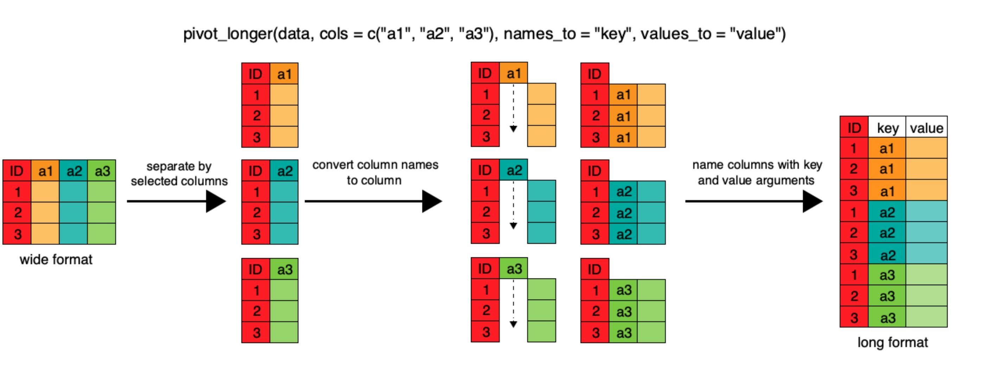

<div class = "blue">

### Learning objectives

* Use conditional statements to create new variables in a dataframe
* Use `join` functions to join two dataframes together
* Describe the concept of a wide and a long table format and for which purpose those formats are useful.
* Reshape a data frame from long to wide format and back with the `pivot_wider` and `pivot_longer` commands from the **`tidyr`** package.

</div>
<br>

## Videos

- [Conditional Statements](https://video.ucdavis.edu/media/Wk5_Conditional_Statements/1_g2weyqu6/420714533)
- [Joins and Reshapes]()
- [Video Discussion](https://canvas.ucdavis.edu/courses/1098028/assignments/1714927)

## In Class Coding

[Submit Week 5 In Class Coding](https://canvas.ucdavis.edu/courses/1098028/assignments/1714940)

<br>

## Conditional Statements

When working with your data, you may want to create a new variable in a data frame, but only if certain conditions are true. Conditional statements are a series of logical conditions that can help you manipulate your data to create new variables.

We'll begin again with the international environmental agreements data from last week (see the [codebook](https://ucd-rdavis.github.io/R-DAVIS/data/iea_codebook.md) for what each column means), and remember to load in the tidyverse

```{r,results = 'hide', purl = FALSE, warning=FALSE, message=FALSE}
library(tidyverse)
agreements <- read_csv("https://ucd-rdavis.github.io/R-DAVIS/data/iea_agreements.csv")
```

The general logic of conditional statements is this: if a statement is true, then execute x, if it is false, then execute y. For example, let's say that we want to create a categorical variable for the size of each agreement. Using the summary function below, we see that the mean number of members is 20.33, so let's split the data at the mean using a conditional statement.

```{r}
summary(agreements$n_members)
```

Notice how different the mean (20.33) and the median (2) are. Most agreements are bilateral, with exactly two members, while a few global treaties have nearly 200. Keep that in mind; we'll come back to it in the lab.

### ifelse() function

To do this, we define the logic: if the number of members is less than the mean of 20.33, assign "small" to this new variable, otherwise, assign "big" to this new variable. We can call this `size_cat` to specify the categorical variable. We will first do this using the `ifelse()` function, where the first argument is a TRUE/FALSE statement, the second argument is the new variable if the statement is true, and the third argument is the new variable if the statement is false.
```{r}
agreements$size_cat <- ifelse(agreements$n_members < 20.33, "small", "big")
head(agreements$size_cat)
```

### case_when() function

The tidyverse provides a way to integrate conditional statements by combining `mutate()` with the conditional function: `case_when()`. This function uses a series of two-sided formulas where the left-hand side describes the condition, and the right supplies the result. The final condition should always be TRUE, meaning that when the previous conditions have not been met, assign the last value. Using this function we can re-write the `size_cat` variable using the tidyverse.

A note: Always be cautious about what might be left out when naming the conditions. In the previous `ifelse()` example we saw that NAs in the data remained NAs in the new variable construction. However, this is not so when using `case_when()`. Instead, this function takes the last argument to mean "anything that is left" rather than n_members > 20.33 == F. So when we run the equivalent conditions in this function, it assigns "small" where `n_members` is NA.

```{r}
agreements %>%
  mutate(size_cat = case_when(
    n_members > 20.33 ~ "big",
    TRUE ~ "small"
  )) %>%
  select(n_members, size_cat) %>%
  head()
```

To adjust for this, we need to add in more than one condition:

```{r}
agreements %>%
  mutate(size_cat = case_when(
    n_members > 20.33 ~ "big",
    is.na(n_members) ~ NA_character_,
    TRUE ~ "small"
  )) %>%
  select(n_members, size_cat) %>%
  head()
```

<div class = "blue">

### Challenge

Using the `agreements` data frame, create a new variable called `era` that sorts agreements into three groups by the year they were signed, using two landmark UN environment conferences as dividing lines:

* "early" (signed before 1972, the year of the Stockholm Conference)
* "middle" (signed from 1972 up to, but not including, 1992)
* "recent" (signed in 1992, the year of the Rio Earth Summit, or later)

Use your function of choice: `ifelse()` or `case_when()`. Be careful: 130 agreements have no `year_signed`, and their `era` should stay `NA`. Then use `count()` to see how many agreements fall in each era.

<details>
<summary>ANSWER</summary>
```{r challenge1, purl=FALSE}

agreements$era <- ifelse(agreements$year_signed < 1972, "early",
                    ifelse(agreements$year_signed >= 1972 &
                             agreements$year_signed < 1992, "middle",
                           "recent"))

agreements %>%
  mutate(
    era = case_when(
      year_signed < 1972 ~ "early",
      year_signed >= 1972 & year_signed < 1992 ~ "middle",
      year_signed >= 1992 ~ "recent")) %>%
  count(era)

```
Notice that the `case_when()` version doesn't end with `TRUE ~`. Any row that doesn't match a condition gets `NA`, which is what we want here.
 </details>
</div>
<br>

## Joining two dataframes

Often when working with real data, data might be separated in multiple .csvs. The `join` family of dplyr functions can accomplish the task of uniting disparate data frames together rather easily. There are many kind of `join` functions that dplyr offers, and today we are going to cover the most commonly used function `left_join`.

To learn more about the `join` family of functions, check out this [useful link](https://dplyr.tidyverse.org/reference/join.html).

The IEA data come as three tables, because they describe three different things: agreements, countries, and which countries belong to which agreements. Let's read in the other two.

```{r, message=FALSE}
memberships <- read_csv("https://ucd-rdavis.github.io/R-DAVIS/data/iea_memberships.csv")
countries <- read_csv("https://ucd-rdavis.github.io/R-DAVIS/data/iea_countries.csv")
```

The `join` functions join dataframes together based on shared columns between the two data frames. Let's see what these data frames look like.

```{r}
str(memberships)
str(countries)
```

`memberships` has 75,791 rows, one for each country's participation in an agreement, with the years it signed, joined, and (rarely) left. `countries` has 202 rows, one per country, with its continent, its OECD and EU membership, and its 2020 population, GDP per capita, and democracy score. Luckily, both data frames have the column `country`. We can use this shared column to `join` the two data frames together.

The basic structure of a `join` looks like this:

`join_type(TableA, TableB, by=columnTojoinBy)`

#### There are many different kinds of join types:

- `inner_join` will return all the rows from Table A that has *matching values* in Table B, and all the columns from both Table A and B

- `left_join` returns all the rows from Table A with all the columns from both A and B. Rows in Table A that have no match in Table B will return NAs

- `right_join` returns all the rows from Table B and all the columns from table A and B. Rows in Table B that have no match in Table A will return NAs.

- `full_join` returns all the rows and all the columns from Table A and Table B. Where there are no matching values, returns NA for the one that is missing.

For our data we are going to use a `left_join`. We want all the rows from the `memberships` data frame, and we want all the columns from both data frames to be in our new data frame.

```{r}
memberships_joined <- left_join(memberships, countries, by = "country")
```

If we don't include the `by = ` argument, the default is to join by all the variables with common names across the two data frames. Let's take a look at our new `memberships_joined` data frame:

```{r}
str(memberships_joined)
```
We now have a new data frame called `memberships_joined` which has all of the information from our original `memberships` data frame, plus the country information (continent, population, and so on) for each row. Each country's information gets repeated on every one of its membership rows.

Does every row in `memberships` have a match in `countries`? Let's try an `inner_join`, which keeps only the rows that match:

```{r}
memberships_inner <- inner_join(memberships, countries, by = "country")
nrow(memberships_joined)
nrow(memberships_inner)
```

The inner join lost 1,366 rows. To see which ones, `anti_join()` returns the rows of Table A that have *no* match in Table B:

```{r}
anti_join(memberships, countries, by = "country") %>%
  count(country, sort = TRUE)
```

Not every party to an environmental agreement is a present-day country. The European Union signs treaties as a bloc, and older agreements were signed by countries that no longer exist, like East Germany, Prussia, and Yugoslavia. In `memberships_joined` those rows have `NA` for every column that came from `countries`. Neither join is "right": it depends on whether you want to keep those parties in your analysis.

We can join `memberships` to `agreements` in the same way, using the column they share, `iea_id`:

```{r}
memberships_agreements <- left_join(memberships, agreements, by = "iea_id")
```

<div class = "blue">

### Challenge

1. Filter `countries` so that only countries in Oceania remain, and call this `countries_oceania`.
2. Join the `memberships` data to `countries_oceania` (i.e. left join with `countries_oceania` on the left). Name it `oceania_left`. How many rows are there?
3. Join `countries_oceania` to the `memberships` data (i.e. right join with `countries_oceania` on the left). Name it `oceania_right`. How many rows are there? Why does `continent` have so many `NA`s?

<details>
<summary>ANSWER</summary>
```{r, purl=FALSE}
# 1.
countries_oceania <- countries %>%
  filter(continent == "Oceania") # 16 countries

# 2.
oceania_left <- left_join(countries_oceania, memberships, by = "country")
nrow(oceania_left) # one row per Oceania country per agreement

# 3.
oceania_right <- right_join(countries_oceania, memberships, by = "country")
nrow(oceania_right) # every row of memberships; non-Oceania rows get NA for the countries columns

```

 </details>
</div>
<br>

## Reshaping with pivot functions

In the spreadsheet lesson we discussed how to structure our data leading to the four rules defining a tidy dataset:

1. Each variable has its own column
2. Each observation has its own row
3. Each value must have its own cell
4. Each type of observational unit forms a table

The IEA data are a good example of the fourth rule: agreements, countries, and memberships are different units, so each gets its own table, and we just saw how to join them back together when we need to.

In `agreements`, each row contains the values of variables associated
with one agreement, like its subject or the year it was signed. What if instead of comparing agreements, we
wanted to compare how many agreements were signed on each subject in each decade?

We'd need to create a new table where each row (the unit) is comprised of values of variables associated with each subject. In practical terms this means the values
of the decades would become the names of column variables and the cells would contain the number of agreements signed in that decade.

Having created a new table, it is therefore straightforward to see how attention to
different environmental issues has changed over time. The key point here is that we are still following a tidy data structure,
but we have **reshaped** the data according to the observations of interest:
agreements per subject per decade instead of one row per agreement.

The opposite transformation would be to transform column names into values of
a variable.

We can do both these of transformations with two new `tidyr` functions, `pivot_longer()` and `pivot_wider()`.

### `pivot_wider`

`pivot_wider()` widens data by *increasing* the number of columns and *decreasing* the number of rows. It takes three main arguments:

1. the data
2. `names_from` the name of the column you'd like to spread out
3. `values_from` the data you want to fill all your new columns with

Let's try an example using our agreements data. How many agreements on each subject were signed in each decade since 1950? How would we create a dataframe that would tell us that information?

First, we need to count the agreements for each subject in each decade:
```{r}
agreements_decade <- agreements %>%
  filter(year_signed >= 1950) %>%
  mutate(decade = floor(year_signed / 10) * 10) %>%
  count(subject, decade)

str(agreements_decade) #let's take a look at the data

```
(`floor()` rounds down, so `floor(1987 / 10) * 10` is 1980.) In `agreements_decade` there are 82 rows and 3 columns. Using `pivot_wider` we are going to *increase* the number of columns and *decrease* the number of rows. We want each row to signify a single subject, with the number of agreements listed for each decade. How many rows do we want our final data frame to have?

```{r}

unique(agreements_decade$subject) #lists every unique subject in agreements_decade

n_distinct(agreements_decade$subject) #another way to look at the number of distinct subjects

```
There are 11 unique subjects, so we want to create a data frame with just 11 rows. How many columns would we want? Since we want each column to be a distinct decade, our number of columns should equal our number of decades.
```{r}
n_distinct(agreements_decade$decade)
```
Alright, so we want a data frame with 11 rows and 8 columns for each of the decades (plus one more column for the subject). `pivot_wider` can do the job!

```{r}
agreements_wide <- agreements_decade %>%
  pivot_wider(names_from = "decade", values_from = "n")

agreements_wide
```
Reading across a row shows the history of one issue. Pollution agreements took off in the 1990s and have kept coming, and trade-and-environment agreements first appear in the 1990s. Notice the `NA`s, too: no trade-and-environment agreements were signed in the 1950s–1980s, so `count()` never made a row for those combinations, and `pivot_wider` has nothing to put in those cells. Here the honest value is 0, and you could fill it in with `pivot_wider(..., values_fill = 0)`. Think about whether a missing combination means "zero" or "unknown" before you fill it.

### `pivot_longer`

`pivot_longer` lengthens data by *increasing* the number of rows and *decreasing* the number of columns. This function takes 4 main arguments:

1. the data
2. `cols`, the column(s) to be pivoted (or to ignore)
3. `names_to` the name of the new column you'll create to put the column names in
4. `values_to` the name of the new column to put the column values in



Let's pretend that we got sent the dataset we just created (`agreements_wide`) and we want to reshape it to be in a long format. We can easily do that using `pivot_longer`

```{r, purl=FALSE}
#cols = columns to be pivoted. Here we want to pivot all the decade columns, but not the "subject" column
#names_to = the name of the new column we created from the `cols` argument
#values_to = the name of the new column we will put our values in

agreements_long <- agreements_wide %>%
  pivot_longer(cols = -subject, names_to = "decade", values_to = "n")

```
This data set should look just like `agreements_decade`. But this one is 88 rows, and `agreements_decade` is 82 rows. What's going on?

```{r, eval = F}
View(agreements_long)
```

Looks like all the NAs are included in this data set. This is always going to happen when moving between `pivot_longer` and `pivot_wider`, but is actually a useful way to balance out a dataset so every subject has a row for every decade. Luckily, we already know how to remove the NAs if we want!
```{r}
agreements_long <- agreements_long %>%
  filter(!is.na(n)) #now 82 rows
```

One more difference: `decade` is now a character column, because it came from column names. `mutate(decade = as.numeric(decade))` would turn it back into a number.

`pivot_wider` and `pivot_longer` are both new additions to the `tidyverse` which means there are some cool new blog posts detailing all their abilities. If you'd like to read more about this group of functions, check out these links:

- [Blog post by Bruno Rodrigues](https://brodrigues.co/posts/2019-03-20-pivot.html)
- [tidyr's vignette](https://tidyr.tidyverse.org/articles/pivot.html)
- [Hiroaki Yutani's slides](https://speakerdeck.com/yutannihilation/a-graphical-introduction-to-tidyrs-pivot-star?slide=1)

<div class = "blue">

### Challenge

1. Use `pivot_wider` to make a table with `continent` as rows, decades (from 1950 on) as columns, and the number of different countries that joined at least one agreement in that decade as the values. You will need to join `memberships` to `countries` first, then summarize before
  reshaping, and use the function `n_distinct()` to get the number of unique
  countries within a particular chunk of data.
2. The `countries` data set has three measurement columns: `population`, `gdp_per_capita`, and `democracy_index`.  This makes it
   difficult to do things like compute the same summary of every measurement for each continent. Let's walk through a
   common solution for this type of problem. First, use `pivot_longer()` to create a
    dataset where we have a new column called `measurement` and a
   `value` column that takes on the value of either `population`, `gdp_per_capita`, or `democracy_index`. *Hint*: You'll need to specify which columns are being selected to make longer.
Then with this new data set, calculate the average of each
   `measurement` for each `continent`. Then
   use `pivot_wider()` to get them into a data set with a column for each measurement. *Hint*: You only need to specify the `names_from =` and `values_from =`
    columns

<details>
<summary>ANSWER</summary>
```{r, purl=FALSE}
## Answer 1
q1 <- memberships %>%
  filter(year_joined >= 1950) %>%
  inner_join(countries, by = "country") %>%
  mutate(decade = floor(year_joined / 10) * 10) %>%
  group_by(continent, decade) %>%
  summarize(n_countries = n_distinct(country)) %>%
  pivot_wider(names_from = "decade", values_from = "n_countries")

q1

## Answer 2
q2a <- countries %>%
  pivot_longer(cols = c("population", "gdp_per_capita", "democracy_index"), names_to = "measurement", values_to = "value")

#cols = columns we want to manipulate
#names_to = name of new column
#values_to = the values we want to fill our new column with (here we already told the function that we were interested in population, gdp_per_capita, and democracy_index, so it will automatically fill our new column, which we named "value", with those numbers.)

q2b <- q2a %>%
  group_by(measurement, continent) %>%
  summarize(mean_value = mean(value, na.rm = TRUE)) %>%
  pivot_wider(names_from = "measurement", values_from = "mean_value")
q2b
```
 </details>
</div>
<br>

## Exporting data

Now that you have learned how to use **`dplyr`** to extract information from
or summarize your raw data, you may want to export these new datasets to share
them with your collaborators or for archival.

Similar to the `read_csv()` function used for reading CSV files into R, there is
a `write_csv()` function that generates CSV files from data frames.

Before using `write_csv()`, we are going to create a new folder, `data_output`,
in our working directory that will store this generated dataset. We don't want
to write generated datasets in the same directory as our raw data. It's good
practice to keep them separate. The `data` folder should only contain the raw,
unaltered data, and should be left alone to make sure we don't delete or modify
it. In contrast, our script will generate the contents of the `data_output`
directory, so even if the files it contains are deleted, we can always
re-generate them.

 - Type in `write_` and hit TAB. Scroll down and take a look at the many options that exist for writing out data in R. Use the F1 key on any of these options to read more about how to use it.

To save our table of agreements per subject per decade:

```{r, eval=FALSE, purl=FALSE}
write_csv(agreements_wide, "data_output/agreements_by_decade.csv")
```

This lesson is adapted from the Data Carpentry: R for Data Analysis and Visualization of Ecological Data
[Manipulating, analyzing and exporting data with tidyverse materials](https://datacarpentry.org/R-ecology-lesson/03-dplyr.html).
Data are from the International Environmental Agreements Database Project, hosted by Université Laval, available at https://www.iea.ulaval.ca, and described in Mitchell et al. (2020), "What We Know (and Could Know) About International Environmental Agreements," *Global Environmental Politics* 20(1): 103–121, https://doi.org/10.1162/glep_a_00544. The course files are a simplified subset of the database prepared for teaching (see the [codebook](https://ucd-rdavis.github.io/R-DAVIS/data/iea_codebook.md)); for research, use the full database from the IEADB website.
