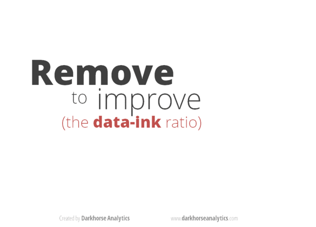

<div class = "blue">

### Learning Objectives

* Describe what faceting is and apply faceting in ggplot.
* Use themes to change the look of a plot.
* Choose a type of plot that fits your question.
* Choose a color palette (qualitative, sequential, or diverging) that fits your data.
* Add titles, labels, and annotations to a plot.
* Save plots with `ggsave()`.
</div>
<br>

## Videos

- [Data visualization: Faceting and Themes]
- [Data visualization: Best Practices]
- [Video Discussion](https://canvas.ucdavis.edu/courses/1098028/assignments/1714923)

## In Class Coding

[Submit Week 8 In Class Coding](https://canvas.ucdavis.edu/courses/1098028/assignments/1714942)

```{r setup, include=FALSE, echo=FALSE, results='hide'}
# Packages used in this lesson
required_packages <- c(
  "tidyverse"      # data manipulation and plotting (includes ggplot2)
)

new_packages <- required_packages[!(required_packages %in% installed.packages()[,"Package"])]
if(length(new_packages)) install.packages(new_packages, repos = "http://cran.us.r-project.org")

invisible(lapply(required_packages, library, character.only = TRUE))
```

<br>

# Faceting and Themes

Last week we finished up by plotting the number of filings per year for each agency. This week we'll pick up right where we left off. First, let's load the EIS data and remake the columns we need from last week:

```{r eis-setup, message=FALSE, purl=FALSE}
eis <- read_csv("https://ucd-rdavis.github.io/R-DAVIS/data/eis_clean.csv") %>%
  filter(filed_year <= 2025)

eis <- eis %>%
  mutate(stage = case_when(
    str_detect(document_type, "Draft") ~ "Draft",
    str_detect(document_type, "Final") ~ "Final",
    TRUE ~ "Other"
  ))

top_agencies <- eis %>%
  count(lead_agency, sort = TRUE) %>%
  slice_head(n = 6) %>%
  pull(lead_agency)

eis <- eis %>%
  mutate(agency = if_else(lead_agency %in% top_agencies, lead_agency, "Other agencies"))

yearly_counts <- eis %>%
  count(filed_year, agency)
```

## Faceting

**`ggplot2`** has a special technique called *faceting* that allows the user to split one
plot into multiple plots based on a factor included in the dataset. We will use it to
make a time series plot for each agency:

```{r first-facet, purl=FALSE}
ggplot(data = yearly_counts, mapping = aes(x = filed_year, y = n)) +
    geom_line() +
    facet_wrap(~ agency)
```

By default every panel uses the same y-axis, which makes it easy to compare agencies to each other but squashes the smaller ones. If you'd rather give each panel its own y-axis, use `scales = "free_y"`:

```{r facet-free, purl=FALSE}
ggplot(data = yearly_counts, mapping = aes(x = filed_year, y = n)) +
    geom_line() +
    facet_wrap(~ agency, scales = "free_y")
```


<div class = "blue">

### Challenge

You are looking at a new dataset shared with you by a collaborator. You received the dataset shortly after the vernal equinox. Your collaborator didn't really give you any context on what the data represent, and you need to do some preliminary visualizations before you can really even formulate a question for them. Import the mystery dataset using:

```{r}
mystery <- read_csv("https://ucd-rdavis.github.io/R-DAVIS/data/mysteryData.csv")
```

Can you figure out what this dataset represents?

*Hint* Use your new knowledge of faceting to break up the data into groups, and consider changing the size and transparency of your `geom_`'s to get a better look!

<details>
<summary>ANSWER</summary>
```{r}
# Preview the data
mystery %>%
  head(5)
# Plot the data
ggplot(data = mystery, mapping = aes(x = x, y = y)) +
     facet_wrap(~ Group) +
     geom_point(size = 0.1, alpha = 0.01)
```

If all went well, and you faceted by group, set points to be very small, and transparency to be very high (i.e., a low `alpha` setting), you should discover that each group is the outline of a different animal! You may notice that there is some distortion going on, and our foxy friend in Group B appears to have some thick thighs. Try equalizing the coordinate space in the x- and y-axes by adding a `coord_equal()` to your `ggplot()` call:

```{r}
## Equalize coordinate mapping
ggplot(data = mystery, mapping = aes(x = x, y = y)) +
  facet_wrap(~ Group) +
  geom_point(size = 0.1, alpha = 0.01) +
  coord_equal()
```

This challenge was inspired by Trevor Branch's [Coelocanth post on Twitter](https://twitter.com/TrevorABranch/status/1227493205337182209) and adapted by [Christian John](https://jepsonnomad.github.io/).

</details>
</div>

<br>

## **`ggplot2`** themes

ggplot Themes are a great, easy addition that can make all your plots more readable (and a lot more pretty!)

In addition to `theme_bw()`, which changes the plot background to white, **`ggplot2`**
comes with several other themes which can be useful to quickly change the look
of your visualization. The complete list of themes is available
at <https://ggplot2.tidyverse.org/reference/ggtheme.html>. `theme_minimal()` and
`theme_light()` are popular, and `theme_void()` can be useful as a starting
point to create a new hand-crafted theme.


Usually plots with white background look more readable when printed.  We can set
the background to white using the function `theme_bw()`. Additionally, you can remove
the grid:

```{r facet-by-agency-white-bg, purl=FALSE}
 ggplot(data = yearly_counts, mapping = aes(x = filed_year, y = n)) +
     geom_line() +
     facet_wrap(~ agency) +
     theme_bw() +
     theme(panel.grid = element_blank())
```

<div class = "blue">

### Challenge 1

Let's make one final change to our facet wrapped plot of our yearly count data. What if we wanted to split the counts for each agency up by stage, where the lines for drafts and finals are different colors? Leave out the "Other" stage. Make sure you have a nice theme on your graph too!

*Hint* Make a new dataframe using the `count` function we learned earlier!

<details>
<summary>ANSWER</summary>
```{r}
#new data frame counting the number of filings of each stage for each agency
 yearly_stage_counts <- eis %>%
                        filter(stage != "Other") %>%
                        count(filed_year, agency, stage)

#plot code
 ggplot(data = yearly_stage_counts, mapping = aes(x = filed_year, y = n, color = stage)) +
     geom_line() +
     facet_wrap(~ agency) +
     theme_bw()
```
</details>
</div>

<br>

<div class = "blue">

### Challenge 2

Remember all those `NA` values in `epa_impact`? Use what you just learned to create a plot that depicts how the share of filings the EPA rated (the ones where `epa_impact` is not `NA`) changes through the years for each agency. What do you notice?

*Hint* `mean()` of a column of `TRUE` and `FALSE` values gives you the share that are `TRUE`.

<details>
<summary>ANSWER</summary>
```{r share-rated-time-series, purl=FALSE}

#create a new dataframe
yearly_rated <- eis %>%
                group_by(filed_year, agency) %>%
                summarize(share_rated = mean(!is.na(epa_impact)))


ggplot(data = yearly_rated, mapping = aes(x = filed_year, y = share_rated)) +
  geom_line() +
  facet_wrap(~ agency) +
  theme_bw()
```

Up until around 2015, the EPA rated most of the filings from every agency. After that the share drops, and by 2019 almost none of the filings in our data have a rating. This is a good reminder to look at where your `NA` values are before you draw conclusions.

</details>
</div>

<br>

# Data Visualization Best Practices

## Data Visualization in R

There are many tips and tricks that are available for the multitude of visualization packages in R. However, there aren't as many simple rules or suggestions on what actually makes a good visualization. This starts with the "grammar of graphics", which is the fundamental rules or principals which describe an art or science (from Wickham 2010).

 > "A good grammar will allow us to gain insight into the composition of complicated graphics, and reveal unexpected connections between seemingly different graphics (Cox 1978)"

Because there are so many options and methods to plot our data in R, we need to think about how we are going to represent the data, how can that data be interpreted visually, and what story it may tell.

A very nice example of this is provided by this animation (created by Darkhorse Analytics, and used in Jenny Bryan's [stat545](https://stat545.com/effective-graphs.html) course). It shows how *simplification* can make a big difference in communication.



### Exploration vs. Communication

One thing to consider is what the objective is when creating a visualization or plot. When we build plots for exploratory purposes, we already know what the variables are we are using, and the objective is more about what sort of patterns the data might show. When communicating, the objective is more about providing a stand-alone snapshot which helps others *understand* what you are trying to convey.

### Pick the plot for your question

Most of the plots you'll make answer one of a handful of questions, and each question has a kind of plot that usually works best. You've already made all of these:

* **How much?** (amounts): bar charts, like our count of filings for each agency
* **How is it spread out?** (distributions): histograms and boxplots, like `comment_days` and `epa_lag` last week
* **What share?** (proportions): stacked or filled bar charts
* **How are two things related?** (relationships): scatter plots
* **How does it change?** (time series): line plots, like our yearly counts

If you want to go deeper, Claus Wilke's free online book [*Fundamentals of Data Visualization*](https://clauswilke.com/dataviz/) has a chapter on each of these, and is opinionated in a helpful way about which plots work and which don't.

## Bar charts

### Order your bars

Here's our count of filings for each agency from last week:

```{r bar-alpha}
ggplot(data = eis, mapping = aes(y = agency)) +
  geom_bar()
```

The agencies are in alphabetical order, which doesn't tell us anything. It's much easier to compare the bars if they're sorted by size. The function `fct_infreq()`, from the tidyverse package **`forcats`**, orders a variable from the most common value to the least:

```{r bar-infreq}
ggplot(data = eis, mapping = aes(y = fct_infreq(agency))) +
  geom_bar()
```

That's closer, but the biggest bar is at the bottom. `fct_rev()` flips the order. And "Other agencies" isn't really one agency, so it makes more sense at the end, no matter how big it is. `fct_relevel()` moves it to the front of the list, which puts it at the bottom of the plot:

```{r bar-ordered}
eis_ordered <- eis %>%
  mutate(agency = fct_rev(fct_infreq(agency)),
         agency = fct_relevel(agency, "Other agencies"))

ggplot(data = eis_ordered, mapping = aes(y = agency)) +
  geom_bar()
```

### Where should the axis start?

Let's count up the total number of filings each year and plot them as a line:

```{r line-total}
yearly_total <- eis %>%
  count(filed_year)

ggplot(data = yearly_total, mapping = aes(x = filed_year, y = n)) +
  geom_line()
```

Notice that ggplot didn't start the y-axis at zero. It starts a little below the smallest value, so the line fills up the plot. That's fine for a line plot. We read a line by how it goes up and down, not by how far it is from the bottom of the plot.

Now let's compare the number of draft statements to the number of final statements, cropping the y-axis the same way with `coord_cartesian()`:

```{r bar-truncated}
eis %>%
  filter(stage != "Other") %>%
  ggplot(mapping = aes(x = stage)) +
  geom_bar() +
  coord_cartesian(ylim = c(7500, 9000))
```

Why is this figure misleading? Look at how long each bar is compared to the actual numbers on the y-axis.

Here's the same plot with the y-axis starting at zero:

```{r bar-zero}
eis %>%
  filter(stage != "Other") %>%
  ggplot(mapping = aes(x = stage)) +
  geom_bar()
```

The cropped version makes it look like there are about four times as many drafts as finals. There are actually 8,697 drafts and 7,963 finals, so the difference is pretty small. We read a bar by its length, so if the axis doesn't start at zero, the lengths lie. Bar charts should always start at zero.

### Pie charts

Pie charts are popular, but it's hard to compare the sizes of slices, especially when they're close. ggplot doesn't have a pie chart geom, but you can make one by wrapping a bar chart into a circle with `coord_polar()`:

```{r pie}
ggplot(data = eis, mapping = aes(x = "", fill = agency)) +
  geom_bar() +
  coord_polar(theta = "y")
```

Is the Army Corps of Engineers slice bigger or smaller than the Bureau of Land Management slice? Hard to say. If you want to show shares, a filled bar chart is usually easier to read. `position = "fill"` stretches every bar to the same length, so each one shows proportions instead of counts:

```{r bar-fill}
eis %>%
  filter(stage != "Other") %>%
  ggplot(mapping = aes(y = agency, fill = stage)) +
  geom_bar(position = "fill")
```

## Color

There are so many options in R. It is fun to play around with color, but the most important thing is to pick colors that match your data. There are three main kinds of color palettes:

* **Qualitative**: for categories that don't have an order, like agencies. The colors should look different from each other, but no color should look "bigger" than another.
* **Sequential**: for values that go from low to high. The colors go from light to dark.
* **Diverging**: for values that go above and below a meaningful middle, like zero. The colors get darker in two directions, with a light color in the middle.

### Qualitative palettes

Remember our line plot of yearly filings for each agency? Here it is with ggplot's default colors:

```{r lines-default, fig.width=9}
ggplot(data = yearly_counts, mapping = aes(x = filed_year, y = n, color = agency)) +
  geom_line()
```

The default colors work for categories, but some of them are hard to tell apart, especially for folks with colorblindness. The Okabe-Ito palette was designed so that people with the most common kinds of colorblindness can still tell the colors apart, and it comes with R. `palette.colors()` gives us the colors, and `scale_color_manual()` lets us use our own colors:

```{r lines-okabe, fig.width=9}
ggplot(data = yearly_counts, mapping = aes(x = filed_year, y = n, color = agency)) +
  geom_line() +
  scale_color_manual(values = palette.colors(palette = "Okabe-Ito"))
```

### Using color for emphasis

Even with good colors, seven lines is a lot to follow. If your plot has one main point, you can make everything else gray. Let's say we want to show what happened to the Federal Highway Administration. First we make a column that says whether each row is the agency we care about:

```{r highlight-data}
yearly_highlight <- yearly_counts %>%
  mutate(highlight = agency == "Federal Highway Administration")
```

Then we color by that column. We still need `group = agency` so that ggplot draws a separate line for each agency:

```{r highlight-plot, fig.width=8}
ggplot(data = yearly_highlight, mapping = aes(x = filed_year, y = n, group = agency, color = highlight)) +
  geom_line() +
  scale_color_manual(values = c("grey75", "firebrick"))
```

### Sequential palettes

Here's a new kind of plot: a heatmap. `geom_tile()` draws a square for each year and agency, and we fill it based on the number of filings. We'll save it as an object so we can try a few different color scales:

```{r tile-default, fig.width=9}
eis_heatmap <- ggplot(data = yearly_counts, mapping = aes(x = filed_year, y = agency, fill = n)) +
  geom_tile()

eis_heatmap
```

The number of filings goes from low to high, so ggplot uses a sequential palette by default, from dark blue to light blue. It works, but it's hard to see differences between the blues.

The [`viridis`](https://cran.r-project.org/web/packages/viridis/vignettes/intro-to-viridis.html) palettes are an excellent set of colors that better represent your data, are easier to read for those with colorblindness, and they also tend to print fairly well in grayscale. They're built into ggplot, and you can call upon them using the `scale_fill_viridis_` or `scale_color_viridis_` functions. Note that whether or not you use the fill or color scale function depends on which aesthetic you set in your plot. The functions also have extensions depending on the kind of variable that you want to color: `scale_fill_viridis_d` is for discrete variables while `scale_fill_viridis_c` is for continuous variables.

```{r tile-viridis, fig.width=9}
eis_heatmap +
  scale_fill_viridis_c()
```

What not to do: a rainbow palette.

```{r tile-rainbow, fig.width=9}
eis_heatmap +
  scale_fill_gradientn(colors = rainbow(7))
```

The rainbow doesn't have an order. Is purple more than green? The colors also jump around, so years with 100 and 150 filings look like totally different things, while years with 150 and 200 look about the same.

### Sequential palettes for ordered categories

Categories can have an order too. The EPA's impact ratings go from best to worst, so the colors should too. Let's look at the share of each rating for each agency. We'll use only the rated drafts from 2018 and earlier, since that's when the ratings stop showing up in our data:

```{r rated-data}
drafts_rated <- eis %>%
  filter(stage == "Draft", !is.na(epa_impact), filed_year <= 2018) %>%
  mutate(epa_impact = factor(epa_impact, levels = c("Lack of Objections",
                                                    "Environmental Concerns",
                                                    "Environmental Objections",
                                                    "Environmentally Unsatisfactory")))
```

```{r rated-default, fig.width=10}
ggplot(data = drafts_rated, mapping = aes(y = agency, fill = epa_impact)) +
  geom_bar(position = "fill")
```

The default colors treat the ratings like they have no order. A sequential palette from the [ColorBrewer](https://colorbrewer2.org/) palettes, which are built into ggplot with `scale_fill_brewer()`, makes the order obvious: pale is fine, red is bad.

```{r rated-brewer, fig.width=10}
ggplot(data = drafts_rated, mapping = aes(y = agency, fill = epa_impact)) +
  geom_bar(position = "fill") +
  scale_fill_brewer(palette = "YlOrRd")
```

### Diverging palettes

A diverging palette only makes sense when the middle of your scale means something. Let's ask a different question: was each year busier or slower than usual for that agency? We'll calculate how far above or below its own average each agency was every year, as a percent:

```{r diff-data}
yearly_diff <- yearly_counts %>%
  group_by(agency) %>%
  mutate(pct_diff = (n - mean(n)) / mean(n) * 100) %>%
  ungroup()
```

Now zero means "an average year", so we want white in the middle, one color for busier years and another for slower ones. `scale_fill_gradient2()` does exactly that, with the middle at zero by default:

```{r diff-plot, fig.width=9}
ggplot(data = yearly_diff, mapping = aes(x = filed_year, y = agency, fill = pct_diff)) +
  geom_tile() +
  scale_fill_gradient2(low = "#2166AC", mid = "white", high = "#B2182B")
```

Almost every agency was busier than usual in the 1990s and 2000s, and slower than usual after about 2015.

### Colorblindness

Keep in mind not everyone sees color in the same way, and some folks cannot see certain spectrums of color. About 1 in 12 men and 1 in 200 women have some kind of colorblindness. You can check how your plot looks to them by uploading an image to a simulator like [Coblis](https://www.color-blindness.com/coblis-color-blindness-simulator/). For more on picking colors, check out the [color chapters](https://clauswilke.com/dataviz/color-basics.html) in *Fundamentals of Data Visualization* and this Nature perspective piece on [The misuse of colour in science communication](https://www.nature.com/articles/s41467-020-19160-7).

<div class = "blue">

### Challenge

For each of these plots, which kind of color palette would you use, and why?

1. A map of the number of filings in each state
2. A bar chart of filings for each agency, filled by `stage`
3. A map of the change in filings for each state between the 1990s and the 2010s

Then pick one of the plots we made today and try out a different palette that fits.

<details>
<summary>ANSWER</summary>

1. Sequential. The number of filings goes from low to high.
2. Qualitative. Draft and final don't have an order.
3. Diverging. Some states went up and some went down, and zero (no change) is a meaningful middle.

</details>
</div>

<br>

## Labels and annotation

Our plots so far have used the column names as labels, which is fine while you're exploring, but not when you're showing a plot to someone else. Here's our ordered bar chart from earlier, with all of ggplot's defaults:

```{r labels-default, fig.width=8}
ggplot(data = eis_ordered, mapping = aes(y = agency)) +
  geom_bar()
```

`labs()` lets you set the title, subtitle, axis labels, and a caption. A good title says what the reader should take away from the plot, not just what's on the axes. Let's also change the color and theme:

```{r labels, fig.width=8}
ggplot(data = eis_ordered, mapping = aes(y = agency)) +
  geom_bar(fill = "darkgreen") +
  labs(title = "The Forest Service files more EISs than any other agency",
       subtitle = "Environmental impact statements filed with the EPA, 1987-2025",
       x = "Number of filings",
       y = NULL,
       caption = "Data: U.S. EPA Environmental Impact Statement database") +
  theme_bw()
```

Setting `y = NULL` removes the y-axis label, since the agency names speak for themselves.

The **`scales`** package, which comes with ggplot, has functions to format the numbers on an axis. `label_comma()` adds commas to big numbers:

```{r labels-comma, fig.width=8}
ggplot(data = eis_ordered, mapping = aes(y = agency)) +
  geom_bar(fill = "darkgreen") +
  scale_x_continuous(labels = scales::label_comma()) +
  labs(x = "Number of filings", y = NULL) +
  theme_bw()
```

You can also add text or shapes right onto the plot with `annotate()`. Unlike a geom, `annotate()` doesn't use the data, so you give it the positions yourself. Let's point out the busiest year:

```{r annotate}
ggplot(data = yearly_total, mapping = aes(x = filed_year, y = n)) +
  geom_line() +
  annotate("point", x = 1995, y = 606, color = "firebrick", size = 3) +
  annotate("text", x = 1995, y = 631, label = "606 filings in 1995") +
  labs(x = "Year filed", y = "Number of filings") +
  theme_bw()
```

## Visualization Tips {.tabset .tabset-fade}

This information isn't meant to be comprehensive, but at minimum, it may provide some guidance when you are creating plots and figures.

### Visualization Do's

The most basic tip is keep it simple! Stick with a clean and clear message, what is your plot/figure trying to get across? Data visualization is effective when it is simple, and repackages data into a visual story that is easy to understand.

 - Label appropriately and legibly, including axes, and use text to highlight important bits
 - Use one color to represent each category, consider colorblind/BW friendly palettes
 - Order datasets using logical hierarchy (Make it easy for reader to compare values)
 - Pay attention to scale (e.g., start bar charts at zero)
 - Include your data/outliers where possible


### Visualization Don'ts

A few things to avoid (which basically relates to keeping it simple):

 - Don't try to add too much into one plot...**keep it simple**
 - Don't add color unnecessarily unless it provides a specific function
 - Avoid high contrast colors (red/green or blue/yellow)
 - Don't use 3D charts. They can make it hard to discern or perceive the actual information.
 - Avoid ornamentation (shadowing, extra illustration, etc)
 - Avoid more than 6 categorical colors in a layout unless you are looking at continuous data.
 - Keep fonts simple (avoid unnecessary **bold** or *italicization*)
 - Don't try to compare too many categories or data types in one chart

<br>

## Saving Figures and Plots

A plot you created with ggplot or another plotting package can be saved as .JPEGS (or .tiff, .img, etc) onto you. For any ggplot objects, we recommend using `ggsave`.

First, let's create a new folder in this project called `figures`. Let's save all the figures we create to that folder. `ggsave` will default to saving the last plot you created, however, we think it is always a good idea to specify exactly which plot you want saved. To do that, we have to save our plot as an object.

```{r, eval = F}
ggsave("figures/eis_heatmap.png", eis_heatmap)
```

#### With `ggsave` you can save images as

 - .png, .jpeg, .tiff, .pdf, .bmp, or .svg

#### Other arguments of `ggsave`

 - `scale` can scale the image (multiplicative scaling factor)
 - `width` and `height` let you specify the size of the image in `units` that you specify
 - `dpi` can change the quality of the image; for publication graphs we suggest over 700 dpi

```{r, eval = F}
ggsave("figures/eis_heatmap.png", eis_heatmap, width = 6, height = 4, units = "in", dpi = 700)
```

<br>

This lesson was contributed by [Martha Zillig](https://github.com/MarthaWohlfeil).

This lesson is adapted from the Data Carpentry: R for Data Analysis and Visualization of Ecological Data
[Data visualization with ggplot2 materials](https://datacarpentry.org/R-ecology-lesson/visualizing-ggplot.html).
Data are from the U.S. EPA's [Environmental Impact Statement database](https://cdxapps.epa.gov/cdx-enepa-II/public/action/eis/search). The course file is a cleaned subset prepared for teaching (see the [codebook](https://ucd-rdavis.github.io/R-DAVIS/data/eis_codebook.md)).
