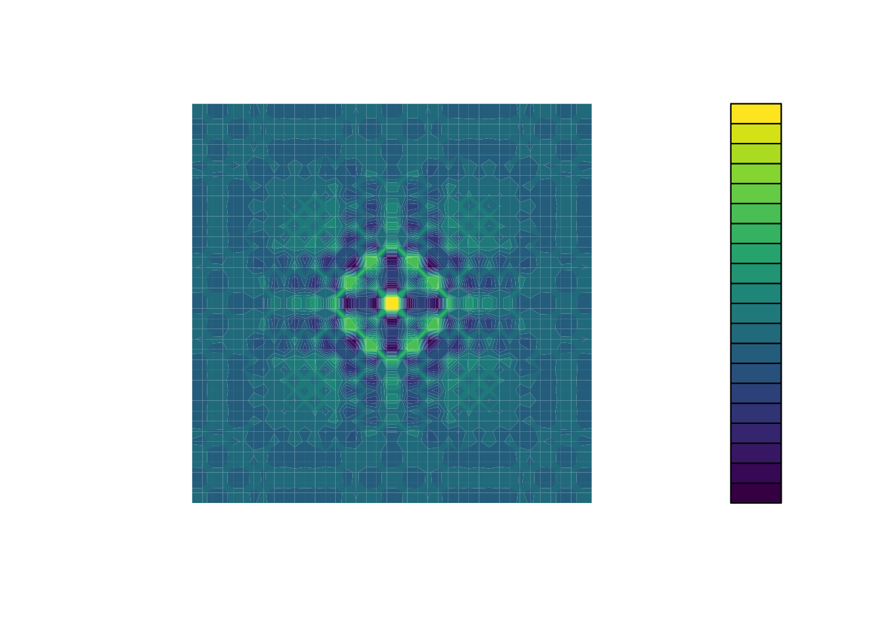

<div class = "blue">

### Under revision

This lecture is being updated for the current quarter — check back soon.

</div>

<!--

<div class = "blue">
### Learning Objectives

* Describe what faceting is and apply faceting in ggplot.
* Use themes to change the look of a plot.
* Learn some basic visualization dos and don'ts
* Learn how to customize color in plots
* Gain a basic understanding of package `cowplot`
* Introduction to interactive `plotly` package
</div>
<br>

## Videos

- [Data visualization Part 2a](https://www.youtube.com/watch?v=aahVpfygvtc)
- [Data visualization Part 2b](https://www.youtube.com/watch?v=0yTQY9doaZM)
- [Data visualization Part 2c](https://video.ucdavis.edu/media/Week7_Saving_and_NonVizViz/1_2fzv6mle/390286133)
- [Video Discussion](https://canvas.ucdavis.edu/courses/1098028/assignments/1714923)

## In Class Coding

[Submit Week 8 In Class Coding](https://canvas.ucdavis.edu/courses/1098028/assignments/1714942)

```{r setup, include=FALSE, echo=FALSE, results='hide'}
# Packages used in this lesson
required_packages <- c(
  "ggplot2",       # plotting
  "cowplot",       # multi-panel figures (bonus)
  "plotly",        # interactive plots (bonus)
  "tidyverse",     # data manipulation and plotting
  "viridis",       # colorblind-friendly palettes
  "RColorBrewer",  # additional palettes
  "sonify",        # sound-based data visualization
  "seewave",
  "BrailleR"       # text descriptions of plots
)

new_packages <- required_packages[!(required_packages %in% installed.packages()[,"Package"])]
if(length(new_packages)) install.packages(new_packages, repos = "http://cran.us.r-project.org")

invisible(lapply(required_packages, library, character.only = TRUE))
```

<br>

# Faceting and Themes

Last week we finished up by plotting the number of filings per year for each agency. This week we'll pick up right where we left off. First, let's load the EIS data and remake the columns we need from last week:

```{r eis-setup, message=FALSE, purl=FALSE}
eis <- read_csv("https://ucd-rdavis.github.io/R-DAVIS/data/eis_clean.csv") %>%
  filter(filed_year <= 2025)

eis <- eis %>%
  mutate(stage = case_when(
    str_detect(document_type, "Draft") ~ "Draft",
    str_detect(document_type, "Final") ~ "Final",
    TRUE ~ "Other"
  ))

top_agencies <- eis %>%
  count(lead_agency, sort = TRUE) %>%
  slice_head(n = 6) %>%
  pull(lead_agency)

eis <- eis %>%
  mutate(agency = if_else(lead_agency %in% top_agencies, lead_agency, "Other agencies"))

yearly_counts <- eis %>%
  count(filed_year, agency)
```

## Faceting

**`ggplot2`** has a special technique called *faceting* that allows the user to split one
plot into multiple plots based on a factor included in the dataset. We will use it to
make a time series plot for each agency:

```{r first-facet, purl=FALSE}
ggplot(data = yearly_counts, mapping = aes(x = filed_year, y = n)) +
    geom_line() +
    facet_wrap(~ agency)
```

By default every panel uses the same y-axis, which makes it easy to compare agencies to each other but squashes the smaller ones. If you'd rather give each panel its own y-axis, use `scales = "free_y"`:

```{r facet-free, purl=FALSE}
ggplot(data = yearly_counts, mapping = aes(x = filed_year, y = n)) +
    geom_line() +
    facet_wrap(~ agency, scales = "free_y")
```


<div class = "blue">

### Challenge

You are looking at a new dataset shared with you by a collaborator. You received the dataset shortly after the vernal equinox. Your collaborator didn't really give you any context on what the data represent, and you need to do some preliminary visualizations before you can really even formulate a question for them. Import the mystery dataset using:

```{r}
mystery <- read_csv("https://ucd-rdavis.github.io/R-DAVIS/data/mysteryData.csv")
```

Can you figure out what this dataset represents?

*Hint* Use your new knowledge of faceting to break up the data into groups, and consider changing the size and transparency of your `geom_`'s to get a better look!

<details>
<summary>ANSWER</summary>
```{r}
# Preview the data
mystery %>%
  head(5)
# Plot the data
ggplot(data = mystery, mapping = aes(x = x, y = y)) +
     facet_wrap(~ Group) +
     geom_point(size = 0.1, alpha = 0.01)
```

If all went well, and you faceted by group, set points to be very small, and transparency to be very high (i.e., a low `alpha` setting), you should discover that each group is the outline of a different animal! You may notice that there is some distortion going on, and our foxy friend in Group B appears to have some thick thighs. Try equalizing the coordinate space in the x- and y-axes by adding a `coord_equal()` to your `ggplot()` call:

```{r}
## Equalize coordinate mapping
ggplot(data = mystery, mapping = aes(x = x, y = y)) +
  facet_wrap(~ Group) +
  geom_point(size = 0.1, alpha = 0.01) +
  coord_equal()
```

This challenge was inspired by Trevor Branch's [Coelocanth post on Twitter](https://twitter.com/TrevorABranch/status/1227493205337182209) and adapted by [Christian John](https://jepsonnomad.github.io/).

</details>
</div>

<br>

## **`ggplot2`** themes

ggplot Themes are a great, easy addition that can make all your plots more readable (and a lot more pretty!)

In addition to `theme_bw()`, which changes the plot background to white, **`ggplot2`**
comes with several other themes which can be useful to quickly change the look
of your visualization. The complete list of themes is available
at <https://ggplot2.tidyverse.org/reference/ggtheme.html>. `theme_minimal()` and
`theme_light()` are popular, and `theme_void()` can be useful as a starting
point to create a new hand-crafted theme.


Usually plots with white background look more readable when printed.  We can set
the background to white using the function `theme_bw()`. Additionally, you can remove
the grid:

```{r facet-by-agency-white-bg, purl=FALSE}
 ggplot(data = yearly_counts, mapping = aes(x = filed_year, y = n)) +
     geom_line() +
     facet_wrap(~ agency) +
     theme_bw() +
     theme(panel.grid = element_blank())
```

<div class = "blue">

### Challenge 1

Let's make one final change to our facet wrapped plot of our yearly count data. What if we wanted to split the counts for each agency up by stage, where the lines for drafts and finals are different colors? Leave out the "Other" stage. Make sure you have a nice theme on your graph too!

*Hint* Make a new dataframe using the `count` function we learned earlier!

<details>
<summary>ANSWER</summary>
```{r}
#new data frame counting the number of filings of each stage for each agency
 yearly_stage_counts <- eis %>%
                        filter(stage != "Other") %>%
                        count(filed_year, agency, stage)

#plot code
 ggplot(data = yearly_stage_counts, mapping = aes(x = filed_year, y = n, color = stage)) +
     geom_line() +
     facet_wrap(~ agency) +
     theme_bw()
```
</details>
</div>

<br>

<div class = "blue">

### Challenge 2

Remember all those `NA` values in `epa_impact`? Use what you just learned to create a plot that depicts how the share of filings the EPA rated (the ones where `epa_impact` is not `NA`) changes through the years for each agency. What do you notice?

*Hint* `mean()` of a column of `TRUE` and `FALSE` values gives you the share that are `TRUE`.

<details>
<summary>ANSWER</summary>
```{r share-rated-time-series, purl=FALSE}

#create a new dataframe
yearly_rated <- eis %>%
                group_by(filed_year, agency) %>%
                summarize(share_rated = mean(!is.na(epa_impact)))


ggplot(data = yearly_rated, mapping = aes(x = filed_year, y = share_rated)) +
  geom_line() +
  facet_wrap(~ agency) +
  theme_bw()
```

Up until around 2015, the EPA rated most of the filings from every agency. After that the share drops, and by 2019 almost none of the filings in our data have a rating. This is a good reminder to look at where your `NA` values are before you draw conclusions.

</details>
</div>

<br>

# Data Visualization Best Practices

## Data Visualization in R

There are many tips and tricks that are available for the multitude of visualization packages in R. However, there aren't as many simple rules or suggestions on what actually makes a good visualization. This starts with the "grammar of graphics", which is the fundamental rules or principals which describe an art or science (from Wickham 2010).

 > "A good grammar will allow us to gain insight into the composition of complicated graphics, and reveal unexpected connections between seemingly different graphics (Cox 1978)"
 
Because there are so many options and methods to plot our data in R, we need to think about how we are going to represent the data, how can that data be interpreted visually, and what story it may tell.

A very nice example of this is provided by this animation (created by Darkhorse Analytics, and used in Jenny Bryan's excellent [stat545](https://stat545.com/effective-graphs.html) course). It shows how *simplification* can make a big difference in communication. 


### Exploration vs. Communication

One thing to consider is what the objective is when creating a visualization or plot. When we build plots for exploratory purposes, we already know what the variables are we are using, and the objective is more about what sort of patterns the data might show. When communicating, the objective is more about providing a stand-alone snapshot which helps others *understand* what you are trying to convey. We'll cover more on this when we talk about `Rmarkdown`.

    
## Color

There are so many options in R. It is fun to play around with color, but keep in mind not everyone sees color in the same way, and some folks cannot see certain spectrums of color (i.e., [absence of blue or green receptors is common](https://www.colormatters.com/color-and-vision/what-is-color-blindness)). See below for a example of what colorblindness may do...if you see numbers inside these circles, great, you have some blue/green retinal receptors.

 

Having said that, [here's a great cheat sheet of colors in R](https://www.nceas.ucsb.edu/~frazier/RSpatialGuides/colorPaletteCheatsheet.pdf), it can be handy when trying to find the correct color or name of a color. Check out this recent Nature perspective piece on [The misuse of colour in science communication](https://www.nature.com/articles/s41467-020-19160-7?utm_source=twitter&utm_medium=social&utm_content=organic&utm_campaign=NGMT_USG_JC01_GL_NRJournals).

### Discrete/Categorical:

For a very nice discussion about color palettes, I recommend [this page](http://www.cookbook-r.com/Graphs/Colors_(ggplot2)/) from the R cookbook folks. 

Additionally, check out the great [ggthemes](https://cran.r-project.org/web/packages/ggthemes/vignettes/ggthemes.html) package, which has many options. One I find very helpful is using `scale_color_colorblind()`, which if you have 8-9 categories, may be a nice way to display your data.

### Continuous: [`viridis`](https://cran.r-project.org/web/packages/viridis/vignettes/intro-to-viridis.html)

The `viridis` package is an excellent set of colors that better represent your data, are easier to read for those with colorblindness, and they also tend to print fairly well in grayscale.

Take a look at the [vignette online](https://cran.r-project.org/web/packages/viridis/vignettes/intro-to-viridis.html)!

An example:



### Customizing color palettes in ggplot

The viridis color palettes have been built into ggplot so that you can call upon them using the scale_fill_viridis_ or scale_color_viridis_ functions. Note that whether or not you use the fill or color scale function depends on which aesthetic you set in your plot. The functions also have extensions depending on the kind of variable that you want to color: scale_fill_viridis_*d* is for discrete variables while scale_fill_viridis_*c* is for continuous variables. Within the function, you can specify which viridis palette to use: A-D.

In this example we fill in our bars with the cut variable in the diamond dataset, a categorical variable with 5 groups. 
```{r, echo=T, eval=T}
library(ggplot2)
ggplot(diamonds, aes(x = clarity, fill = cut)) + 
  geom_bar() +
    theme_classic() +
  theme(axis.text.x = element_text(angle=70, vjust=0.5)) +
  scale_fill_viridis_d(option = "C") 
```

## Visualization Tips {.tabset .tabset-fade}

This information isn't meant to be comprehensive, but at minimum, it may provide some guidance when you are creating plots and figures. 

### Visualization Do's

The most basic tip is keep it simple! Stick with a clean and clear message, what is your plot/figure trying to get across? Data visualization is effective when it is simple, and repackages data into a visual story that is easy to understand. 

 - Label appropriately and legibly, including axes, and use text to highlight important bits
 - Use one color to represent each category, consider colorblind/BW friendly palettes
 - Order datasets using logical hierarchy (Make it easy for reader to compare values)
 - Use icons when possible to reduce unnecessary labeling
 - Pay attention to scale (e.g., start axis at zero not 2.4 to 3.5)
 - Include your data/outliers where possible


### Visualization Don'ts

A few things to avoid (which basically relates to keeping it simple):

 - Don't try to add too much into one plot...**keep it simple**
 - Don't add color unnecessarily unless it provides a specific function
 - Avoid high contrast colors (red/green or blue/yellow)
 - Don't use 3D charts. They can make it hard to discern or perceive the actual information.
 - Avoid ornamentation (shadowing, extra illustration, etc)
 - Avoid more than 6 categorical colors in a layout unless you are looking at continuous data.
 - Keep fonts simple (avoid unnecessary **bold** or *italicization*)
 - Don't try to compare too many categories or data types in one chart
 
### Examples

#### Scatterplots

One of the best simple plots for examining patterns in data, but very effective. Also used when adding model trend lines.

```{r scatterplots}

suppressPackageStartupMessages(library(ggplot2))
plot(x=iris$Petal.Width) # single variable
plot(x=iris$Petal.Width, y=iris$Petal.Length) # multiple variables
ggplot() + geom_point(data=iris, aes(x=Petal.Width, y=Petal.Length))
ggplot() + geom_point(data=iris, aes(x=Petal.Width, y=Petal.Length, fill=Species), pch=21, size=3, alpha=0.5)

```


#### Lineplots

Comparing relative change in quantities across a variable like time. Note the change when we avoid facetting each line independently.

```{r lineplots}
plot(EuStockMarkets)

suppressPackageStartupMessages(library(tidyverse))
EuStockMarkets_df <- data.frame(as.matrix(EuStockMarkets), date=as.numeric(time(EuStockMarkets)))
EuStockMarkets_long <- pivot_longer(EuStockMarkets_df, cols = 1:4, names_to = "Market", values_to = "value")
ggplot() + geom_line(data=EuStockMarkets_long, aes(x=date, y=value, color=Market))

```

#### Barplots

Comparing totals across multiple groups. Notice legibility when you stack the bars.

```{r barplots}

# code adapted from https://www.analyticsvidhya.com/blog/2015/07/guide-data-visualization-r/
suppressPackageStartupMessages(library(viridis))
barplot(iris$Petal.Length)
barplot(iris$Sepal.Length,col  = viridis(3, option = "A")) 
barplot(table(iris$Species,iris$Sepal.Length),col  = viridis(3, option = "A")) 
```

<br>

## Saving Figures and Plots 

A plot you created with ggplot or another plotting package can be saved as .JPEGS (or .tiff, .img, etc) onto you. For any ggplot objects, we recommend using `ggsave`. 

First, let's create a new folder in this project called `figures`. Let's save all the figures we create to that folder. `ggsave` will default to saving the last plot you created, however, we think it is always a good idea to specify exactly which plot you want saved. To do that, we have to save our plot as an object. 

```{r, eval = F}
ggsave("figures/surveys_plot.png", surveys_plot)
```

#### With `ggsave` you can save images as

 - .png, .jpeg, .tiff, .pdf, .bmp, or .svg

#### Other arguments of `ggsave`

 - `scale` can scale the image (multiplicative scaling factor)
 - `width` and `height` let you specify the size of the image in `units` that you specify
 - `dpi` can change the quality of the image; for publication graphs we suggest over 700 dpi

```{r, eval = F}
ggsave("figures/surveys_plot.png", surveys_plot, width = 6, height = 4, units = "in", dpi = 700)
```

<br>

## Non-visual data interaction  


Discussions of visualization so far have taken for granted that visualization is accessible to everyone, but researchers and audiences alike are not all sighted. RStudio is behind on blind accessibility, but some packages can provide text descriptions and sonification/audification of plots to improve accessibility for non-visual data interaction.  

The `BrailleR` package ([read more here](https://r-resources.massey.ac.nz/BrailleRInAction/)), has a `VI()` function that wraps around plots and provides a text-description output. We can use the VI wrapper to interact with our plots from a textual perspective and identify what information is missing. Such text can also be used as alt-text when publishing this material. What could we do to our plot to improve the text description?

```{r, echo=T, eval=T, warning= F, message = F}
#install.packages("BrailleR")
library(BrailleR)

barplot <- ggplot(diamonds, aes(x = clarity, fill = cut)) + 
  geom_bar() +
  theme(axis.text.x = element_text(angle=70, vjust=0.5)) +
  scale_fill_viridis_d(option = "C") +
  theme_classic()

VI(barplot)
```

The `sonification` package's `sonify` function can be used to represent data in audio form, where the x-axis can span sound across time, so that the length of time a sound plays follows the data long the x-axis from left to right; the y-axis can be expressed as pitch, so that the pitch of the sound matches to the values of the data (lower value = lower pitch).

```{r, echo = F, eval = FALSE, warning= F, message = F}
library(sonify)
library(seewave)
sonif <- sonify(iris$Petal.Width)
savewav(sonif, file = "sw.width.sound.wav")
```

One variable can be used as an input to hear the distribution. For instance this univariate plot of iris petal width visually looks like this:
```{r, echo=T, eval=T, warning= F, message = F}
plot(iris$Petal.Width)
```

Using `sonify` instead of plot, the distribution of iris petal width sounds like this:
```{r, echo = T, eval = FALSE, warning= F, message = F}
#install.packages("sonify")
library(sonify)
sonify(iris$Petal.Width)
```
If you try this on your computer it should play automatically, but on the website you can listen below: 

<audio controls>
  <source src="img/sw.width.sound.wav" type="audio/wav">
</audio>

```{r, echo = F, eval = FALSE, warning= F, message = F}
sonif <- sonify(x = iris$Petal.Width, y = iris$Petal.Length)
savewav(sonif, file = "sw.width.length.sound.wav")
```
Two variables can be used as input to hear the relationship between continuous variables. For instance this bivariate plot of iris petal length and petal width visually looks like this:
```{r, echo=T, eval=T, warning= F, message = F}
plot(x = iris$Petal.Width, y = iris$Petal.Length)
```

And using `sonify`, sounds like this:
```{r, echo=T, eval=FALSE, warning= F, message = F}
sonify(x=iris$Petal.Width, y = iris$Petal.Length) 
```

<audio controls>
  <source src="img/sw.width.length.sound.wav" type="audio/wav">
</audio>

# BONUS CONTENT #

This is provided for your reference, but won't be something we cover in class or address on the exam.

## Publishing Plots: `cowplot`

A few excellent options exist for creating multi-paneled plots for publications. The first and foremost is a package by Claus Wilke called [`cowplot`](https://cran.r-project.org/web/packages/cowplot/vignettes/introduction.html). With `cowplot`, it's possible to quickly combine existing `ggplots`, creating publication quality plots. See the vignette for more options, but here's a quick example from the vignette below:

```{r, echo=FALSE, warning = F, message = F}
detach("package:BrailleR", unload=TRUE)
```


```{r cowplot, echo=T, eval=T}
library(cowplot)

# make a few plots:
plot.diamonds <- ggplot(diamonds, aes(clarity, fill = cut)) + 
  geom_bar() +
  theme(axis.text.x = element_text(angle=70, vjust=0.5))
#plot.diamonds

plot.cars <- ggplot(mpg, aes(x = cty, y = hwy, colour = factor(cyl))) + 
   geom_point(size = 2.5)
#plot.cars

plot.iris <- ggplot(data=iris, aes(x=Sepal.Length, y=Petal.Length, fill=Species)) +
  geom_point(size=3, alpha=0.7, shape=21)
#plot.iris

# use plot_grid
panel_plot <- plot_grid(plot.cars, plot.iris, plot.diamonds, labels=c("A", "B", "C"), ncol=2, nrow = 2)

panel_plot

# fix the sizes draw_plot
fixed_gridplot <- ggdraw() + draw_plot(plot.iris, x = 0, y = 0, width = 1, height = 0.5) +
           draw_plot(plot.cars, x=0, y=.5, width=0.5, height = 0.5) +
           draw_plot(plot.diamonds, x=0.5, y=0.5, width=0.5, height = 0.5) + 
  draw_plot_label(label = c("A","B","C"), x = c(0, 0.5, 0), y = c(1, 1, 0.5))

fixed_gridplot
```

## The package `plotly`

The package `plotly` is an excellent, easy to use resource that allows you to quickly create interactive, web-based figures. We have used plotly to illustrate patterns in data to collaborators, to visualize patterns in our data during the pre-analysis stage, and even impress with "fancy" graphics during a conference talk! 

Let's try plotly together using some of the `iris` data: 

```{r, warning = F, message =F}
library(plotly)

plot.iris <- ggplot(data=iris, aes(x=Sepal.Length, y=Petal.Length, fill=Species)) +
  geom_point(size=3, alpha=0.7, shape=21)

plotly::ggplotly(plot.iris) #it's as simple as that! 
```

This lesson was contributed by [Martha Zillig](https://github.com/MarthaWohlfeil).

This lesson is adapted from the Software Carpentry: R for Reproducible 
Scientific Analysis [Vectors and Data Frames materials](http://data-lessons.github.io/gapminder-R/03-data-types-subsetting.html)
and the Data Carpentry: R for Data Analysis and Visualization of Ecological Data 
[Exporting Data materials](http://www.datacarpentry.org/R-ecology-lesson/03-dplyr.html).
-->
